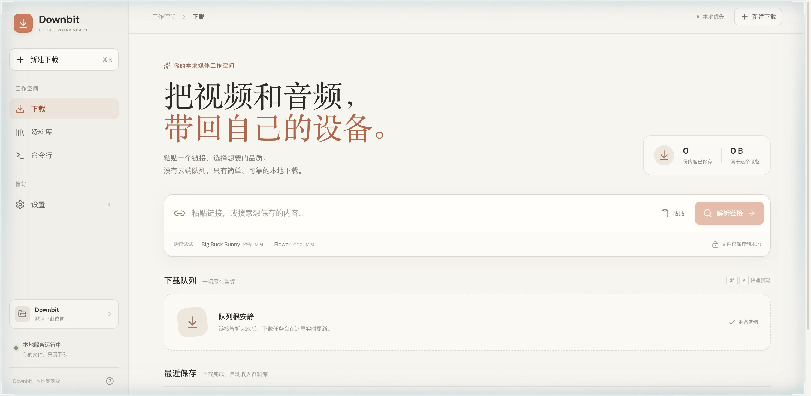

# Video Provider

本地优先的视频与音频下载工作台。一个链接即可完成解析、格式选择、断点续传和资料库整理，同时提供与网页共用任务状态的 CLI。



> Video Provider 是本地优先的媒体工作空间，界面采用暖白与陶土色设计。

## macOS 桌面应用（Apple Silicon）

当前桌面版支持 **Apple Silicon Mac（arm64）**，安装包内置 Electron、Node 服务、yt-dlp 和 FFmpeg，无需另装 Node.js。

1. 打开 `VideoProvider-1.2.0-arm64.dmg`，将 **VideoProvider** 拖入 **Applications（应用程序）**。
2. 从「应用程序」或 Launchpad 打开应用。当前使用 ad-hoc 本地签名，没有经过 Apple 正式签名和公证，首次可能需要在 Finder 中**右键 VideoProvider → 打开**。
3. 如果窗口没有出现，点击程序坞中的应用图标。使用 **VideoProvider → Quit VideoProvider** 或 `Cmd+Q` 退出，本地服务会停止并保存任务状态。

### 使用桌面应用

1. 粘贴 HTTP/HTTPS 链接，或输入搜索内容，先解析并选择所需格式。
2. 确认下载后可在任务中暂停、继续或取消。下载内容默认保存到 `~/Downloads/VideoProvider`，可在设置中修改目录。
3. 在资料库中搜索、筛选、播放已完成的媒体，或定位到系统文件夹。
4. 如需账号功能，在「设置 → 账号与会员」中登录 B 站或小红书。登录使用本机安装的 Chrome 和 Video Provider 独立会话，不读取日常浏览器配置，也不会绕过会员限制。
5. 退出应用不会删除任务记录。更新时先退出应用，再用新 DMG 中的应用替换旧版本；卸载时删除应用即可，个人数据不会自动删除。

### 桌面数据与隐私

- 任务、设置和账号会话保存在 `~/Library/Application Support/VideoProvider/data`，不会包含在安装包中。
- 桌面版不会自动读取源码目录下的 `.downbit/`。如需迁移，请先停止相关服务，备份后复制原数据到上述目录。
- 原 `.downbit/` 和桌面数据可以分别用于源码 CLI 与桌面应用。若要让 CLI 复用桌面任务状态，可设置 `DOWNBIT_DATA_DIR="$HOME/Library/Application Support/VideoProvider/data"`。
- 删除应用不会自动删除下载文件或设置；只有在确认备份后，才自行删除上述数据目录。

### 自行构建桌面安装包

在 Apple Silicon macOS 上运行 `npm run dist:mac`，生成：

- `dist-desktop/mac-arm64/VideoProvider.app`
- `dist-desktop/VideoProvider-1.2.0-arm64.dmg`

`npm run desktop` 用于桌面开发运行，`npm run icon:mac` 用于重新生成图标。打包产物不会提交到 Git，也不会包含个人任务、Cookie、下载文件或设置。

## 浏览器启动器（原方式）

1. 安装 [Node.js 22.12 或更高版本](https://nodejs.org/en/download)。
2. 下载并解压 [Video Provider 1.2.0 源码包](https://github.com/Zc-RUC/video-provider/archive/refs/tags/v1.2.0.zip)。
3. 运行启动器：
   - **macOS**：双击 `VideoProvider.command`（如系统提示，先右键脚本并选择“打开”）。
   - **Windows**：双击 `VideoProvider.bat`。
   - **Linux**：在目录中运行 `./VideoProvider.command`。
4. 首次启动会安装项目依赖以及 yt-dlp / FFmpeg，随后自动打开 `http://127.0.0.1:4317`。

启动器会按需安装依赖并构建前端。首次安装和后续媒体解析需要网络；请保持启动窗口运行，关闭窗口即可停止本地服务。

## 从源码运行

```bash
git clone https://github.com/Zc-RUC/video-provider.git
cd video-provider
npm install
npm run build
npm start
```

打开 `http://127.0.0.1:4317`。开发模式使用 `npm run dev`，Vite 会自动选择可用端口。

## 功能

- **统一入口**：粘贴 HTTP/HTTPS 链接，或通过 yt-dlp 搜索内容。
- **下载前预览**：查看标题、封面、来源、时长、可用格式和合集条目。
- **真实下载引擎**：直链 Range 多连接、HLS 分片与 AES-128、暂停/继续/取消、断点恢复。
- **直播与音频**：HLS 直播持续录制并手动停止保存；视频可提取为 192 kbps MP3。
- **媒体处理**：通过 FFmpeg 合流、封装与写入基础元数据。
- **资料库**：搜索、类型筛选、内置播放、系统文件夹定位、完成通知。
- **命令行**：`info`、`formats`、`get`、`list`、`open`、`pause`、`resume`、`cancel`、`finish`、`remove`，均支持脚本调用。
- **本地设置**：并行任务数、单文件连接数、启动续传、浏览器 Cookies 与通知偏好。

## CLI

无需全局安装即可使用：

```bash
npm run cli -- <url>
npm run cli -- get -a <url>
npm run cli -- get -q 720 -o ~/Movies <url>
npm run cli -- info <url>
npm run cli -- formats <url>
npm run cli -- list --json
```

如需全局命令：

```bash
npm link
video-provider <url>
video-provider list
```

`downbit` 保留为兼容别名。CLI 会复用正在运行的本地服务；服务未运行时会自动启动。网页和终端中的任务状态保持一致。

## 在其他电脑上使用

在新电脑下载 Release 或克隆仓库后按上述步骤运行即可。下载文件、任务记录和设置均保存在那台电脑上，不提供云端同步。

- 任务与设置：项目目录下的 `.downbit/`（可用 `DOWNBIT_DATA_DIR` 修改）。
- 默认下载目录：`~/Downloads/VideoProvider`，可在设置页修改。
- 自定义环境：`YT_DLP_PATH`、`FFMPEG_PATH`、`DOWNBIT_API_PORT`、`DOWNBIT_DOWNLOAD_DIR`、`CHROME_PATH`。
- B 站账号与会员：在「设置 → 账号与会员」点击“登录 B 站”，会打开 Video Provider 独立的 Chrome 登录窗口。登录成功后自动识别账号和会员状态、保存会话，并让网页与 CLI 共用。此功能需要本机安装 Chrome，不读取日常浏览器配置；会话文件权限为 `0600`。
- 小红书：在「设置 → 账号与会员」点击“登录小红书”，完成登录后自动识别 `web_session` 并保存专用会话。分享链接和登录跳转会自动还原为作品页，再由 `XiaoHongShu` 提取器使用同一会话解析和下载。
- 高码率、4K、HDR 等版本取决于视频和账号权限，不会绕过会员限制。其他网站可在设置页选择系统浏览器 Cookies，CLI 对应 `--cookies <browser>`；应用内账号会话优先。

## 技术与隐私

React + Vite + Express；Puppeteer 负责独立账号浏览器，yt-dlp 负责站点解析，FFmpeg 负责音视频处理。服务仅绑定 `127.0.0.1`，不上传媒体到项目服务器。远程内容仍会按你的请求访问来源网站。

Video Provider 提供 macOS 桌面应用、Web 工作台和 CLI，不包含 DRM 破解或独立的浏览器自动嗅探扩展。请仅下载你有权保存的内容，并遵守来源网站条款。

## 开源许可

[MIT](LICENSE)。yt-dlp、FFmpeg 及其他依赖遵循各自许可证。
