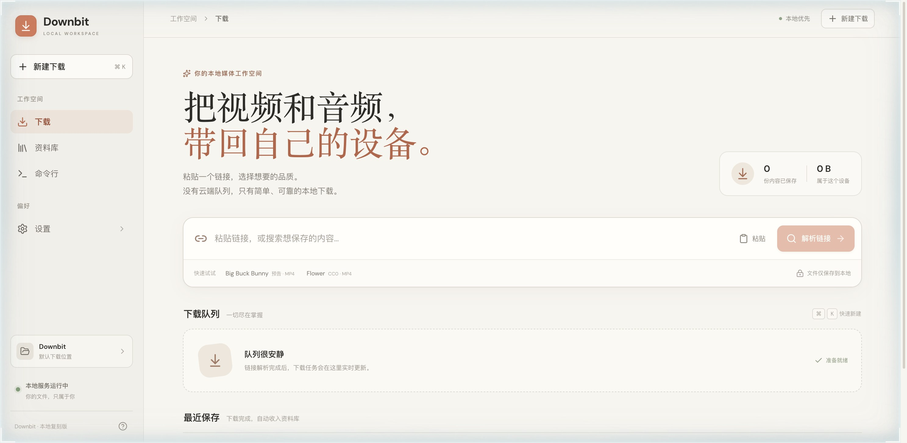

# Downbit Local

本地优先的视频与音频下载工作台。一个链接即可完成解析、格式选择、断点续传和资料库整理，同时提供与网页共用任务状态的 CLI。



> 独立复刻项目，灵感来自 Downbit 的交互模式，并非官方产品。界面采用暖白与陶土色的本地工作台设计。

## 下载即用（推荐）

1. 安装 [Node.js 22.12 或更高版本](https://nodejs.org/en/download)。
2. 前往 [Releases](https://github.com/Zc-RUC/downbit-local/releases/latest)，下载并解压 `Downbit-Local-1.1.4.zip`。
3. 运行启动器：
   - **macOS**：双击 `Downbit.command`（如系统提示，先右键脚本并选择“打开”）。
   - **Windows**：双击 `Downbit.bat`。
   - **Linux**：在目录中运行 `./Downbit.command`。
4. 首次启动会安装项目依赖以及 yt-dlp / FFmpeg，随后自动打开 `http://127.0.0.1:4317`。

Release 已包含构建好的前端，不需要安装开发工具。首次安装和后续媒体解析需要网络；请保持启动窗口运行，关闭窗口即可停止本地服务。

## 从源码运行

```bash
git clone https://github.com/Zc-RUC/downbit-local.git
cd downbit-local
npm install
npm run build
npm start
```

打开 `http://127.0.0.1:4317`。开发模式使用 `npm run dev`，Vite 会自动选择可用端口。

## 功能

- **统一入口**：粘贴 HTTP/HTTPS 链接，或通过 yt-dlp 搜索内容。
- **下载前预览**：查看标题、封面、来源、时长、可用格式和合集条目。
- **真实下载引擎**：直链 Range 多连接、HLS 分片与 AES-128、暂停/继续/取消、断点恢复。
- **直播与音频**：HLS 直播持续录制并手动停止保存；视频可提取为 192 kbps MP3。
- **媒体处理**：通过 FFmpeg 合流、封装与写入基础元数据。
- **资料库**：搜索、类型筛选、内置播放、系统文件夹定位、完成通知。
- **命令行**：`info`、`formats`、`get`、`list`、`open`、`pause`、`resume`、`cancel`、`finish`、`remove`，均支持脚本调用。
- **本地设置**：并行任务数、单文件连接数、启动续传、浏览器 Cookies 与通知偏好。

## CLI

无需全局安装即可使用：

```bash
npm run cli -- <url>
npm run cli -- get -a <url>
npm run cli -- get -q 720 -o ~/Movies <url>
npm run cli -- info <url>
npm run cli -- formats <url>
npm run cli -- list --json
```

如需全局 `downbit` 命令：

```bash
npm link
downbit <url>
downbit list
```

CLI 会复用正在运行的本地服务；服务未运行时会自动启动。网页和终端中的任务状态保持一致。

## 在其他电脑上使用

在新电脑下载 Release 或克隆仓库后按上述步骤运行即可。下载文件、任务记录和设置均保存在那台电脑上，不提供云端同步。

- 任务与设置：项目目录下的 `.downbit/`（可用 `DOWNBIT_DATA_DIR` 修改）。
- 默认下载目录：`~/Downloads/Downbit`，可在设置页修改。
- 自定义环境：`YT_DLP_PATH`、`FFMPEG_PATH`、`DOWNBIT_API_PORT`、`DOWNBIT_DOWNLOAD_DIR`、`CHROME_PATH`。
- B 站账号与会员：在「设置 → 账号与会员」点击“登录 B 站”，会打开 Downbit 独立的 Chrome 登录窗口。登录成功后自动识别账号和会员状态、保存会话，并让网页与 CLI 共用。此功能需要本机安装 Chrome，不读取日常浏览器配置；会话文件权限为 `0600`。
- 小红书：在「设置 → 账号与会员」点击“登录小红书”，完成登录后自动识别 `web_session` 并保存专用会话。分享链接和登录跳转会自动还原为作品页，再由 `XiaoHongShu` 提取器使用同一会话解析和下载。
- 高码率、4K、HDR 等版本取决于视频和账号权限，不会绕过会员限制。其他网站可在设置页选择系统浏览器 Cookies，CLI 对应 `--cookies <browser>`；应用内账号会话优先。

## 技术与隐私

React + Vite + Express；Puppeteer 负责独立账号浏览器，yt-dlp 负责站点解析，FFmpeg 负责音视频处理。服务仅绑定 `127.0.0.1`，不上传媒体到项目服务器。远程内容仍会按你的请求访问来源网站。

这是 Web 工作台与 CLI 的复刻实现，不包含原生安装包、DRM 破解或独立的浏览器自动嗅探扩展。请仅下载你有权保存的内容，并遵守来源网站条款。

## 开源许可

[MIT](LICENSE)。yt-dlp、FFmpeg 及其他依赖遵循各自许可证。
